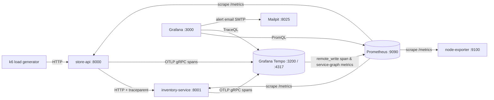

# Monitoring and Data Visualization using Grafana — with Grafana Tempo

DevOps IA-2 case study · K. J. Somaiya College of Engineering · L.Y. B.Tech Computer Engineering · Sem VII (2026-27)
Course: DevOps (216U01E744) · Faculty in-charge: Mr. Swapnil Pawar (SCP)

| Member | Roll no. |
|---|---|
| Amrit Nigam | 16010123038 |
| Omik Acharya | 16010123218 |
| Amandeep Singh | 16010123036 |

## Overview

One `docker compose up` brings up a complete observability stack around two instrumented Python microservices.
**Prometheus** scrapes system metrics (Node Exporter) and application RED metrics; **Grafana Tempo** stores the
distributed traces the services emit via **OpenTelemetry**; **Grafana** shows both on three provisioned
dashboards, links metric spikes to the exact trace (exemplars), and sends **alert emails** (to Mailpit) when a
threshold is crossed. Everything — data sources, dashboards, alert rules, contact points — is provisioned as code.

> Metrics tell you **that** something is wrong (Prometheus + dashboards + alerts). Traces tell you **where and why**
> (Grafana Tempo). Grafana unifies both in one place.



Data flows: **metrics** (`/metrics` → Prometheus every 5 s → PromQL), **traces** (OTel spans → OTLP → Tempo blocks →
TraceQL), **traces → metrics** (Tempo metrics-generator → `traces_spanmetrics_*`, `traces_service_graph_*` → Prometheus),
**metrics → traces** (latency histogram exemplars carry `trace_id` → click opens trace), **alerting** (Grafana evaluates
every 10 s → policy → email contact point → Mailpit).

## Prerequisites

- Docker Engine 24+ with Compose v2 (`docker compose`). Windows: Docker Desktop + WSL2, run commands from WSL2.
- ≥ 4 GB free RAM, ≥ 5 GB disk; `jq` and `python3` for the helper scripts.
- Free ports: 3000, 3200, 4317, 4318, 8000, 8001, 8025, 9090, 9100 (+8081 for cAdvisor).

## Quick start

```bash
cp .env.example .env
docker compose up -d --build          # add  --profile full  for cAdvisor container metrics
./scripts/verify.sh                   # wait ~1-2 min after startup for Tempo-generated metrics
```

`make up`, `make verify`, `make chaos-cpu`, `make restore`, `make clean` … are shortcuts (see `Makefile`).

## URLs and credentials

| URL | What |
|---|---|
| http://localhost:3000 | Grafana (admin / admin) — folder *DevOps IA - Grafana & Tempo* |
| http://localhost:9090/targets | Prometheus targets |
| http://localhost:3200/ready | Tempo readiness (reports `ready` ~15 s after first poll) |
| http://localhost:8000 · :8001 | store-api · inventory-service |
| http://localhost:8025 | Mailpit inbox (alert emails) |
| http://localhost:9100/metrics | Node Exporter (host network; on Docker Desktop reachable from the Mac only if host networking is enabled in settings) |
| http://localhost:8081 | cAdvisor (only with `--profile full`) |

## Demo walkthrough (≈10 min)

1. `docker compose ps`, Prometheus *Targets* — the whole stack is one Compose file.
2. Grafana → *Connections → Data sources* and the dashboards folder — all provisioned from `grafana/provisioning`.
3. **01 - System Overview** — CPU / memory / disk gauges, CPU-by-mode, memory, network, disk I/O, load.
4. **02 - Application Performance** — RED method: request rate, error %, p50/p95/p99 latency, status codes, orders KPI.
5. **03 - Traces & Service Map** — service map (user → store-api → inventory-service), trace tables; Explore → Tempo →
   TraceQL `{ resource.service.name = "store-api" }` → open a trace containing spans of **both** services.
6. `./scripts/chaos-latency.sh` → p95 rises on dashboard 02 → hover the *Latency Percentiles* graph, click an
   **exemplar** dot → *Query with Tempo* → waterfall shows the slow `db.query` span inside inventory-service.
7. `./scripts/chaos-cpu.sh 120` → CPU gauge red → *Alerting → Alert rules*: Pending → Firing → email in Mailpit.
8. `./scripts/chaos-errors.sh` or `./scripts/chaos-kill-inventory.sh` → error-rate / Service Down alerts, error traces.
9. `./scripts/chaos-restore.sh` → everything green; *Resolved* emails arrive.

## Chaos scripts

| Script | Effect | Alert |
|---|---|---|
| `chaos-latency.sh [ms=1500] [s=120] [inventory\|store]` | adds latency inside `db.query`/`db.update` (or store-api spans) | High p95 Latency |
| `chaos-errors.sh [rate=0.4] [s=120]` | store-api returns 500 for a fraction of `/api/*` | High HTTP Error Rate |
| `chaos-cpu.sh [s=120]` | one busy-loop process per core (max 300 s) | High CPU Usage |
| `chaos-kill-inventory.sh` | `docker compose stop inventory-service` → store-api 503s | Service Down |
| `chaos-restore.sh` | restart inventory, reset injection, kill CPU burners | Resolved emails |

Windows PowerShell equivalents: `curl.exe -X POST "http://localhost:8000/chaos/cpu?seconds=120"`,
`curl.exe -X POST "http://localhost:8001/chaos/latency?ms=1500&duration=120"`,
`curl.exe -X POST "http://localhost:8000/chaos/errors?rate=0.4&duration=120"`,
`curl.exe -X POST http://localhost:8000/chaos/reset`, `GET /chaos/status` on either service.

## Dashboards and alerts

Dashboards are generated by `scripts/gen_dashboards.py` (`make dashboards`) into `grafana/dashboards/`:

- **01 - System Overview** (`system-overview`): CPU, memory, disk gauges; uptime, cores, RAM; CPU by mode (80 % line),
  memory breakdown, network rx/tx (mirrored), disk I/O, load, filesystem table.
- **02 - Application Performance** (`app-performance`, `$service` variable): service health, request rate, error %,
  p95, in-flight; RPS by route, status codes, latency percentiles **with exemplars**, error rate, p95 by route, orders/min,
  inventory stock, chaos timeline; collapsed cAdvisor row.
- **03 - Traces & Service Map** (`traces-service-map`): Tempo service map, TraceQL tables (errors, > 500 ms, checkout),
  span rate / p95 / error % from the metrics-generator, service-to-service request and failure rates.

Alert rules (`grafana/provisioning/alerting/alert-rules.yaml`, folder *DevOps IA Alerts*, evaluated every 10 s, query →
reduce(last) → threshold), routed to the `devops-team-email` contact point (Mailpit):

| Rule | Condition | For | Severity |
|---|---|---|---|
| High CPU Usage (primary demo) | host CPU > 80 % | 30 s | critical |
| High Memory Usage | memory > 90 % | 1 m | warning |
| Low Disk Space | root disk > 90 % | 1 m | warning |
| High HTTP Error Rate | 5xx > 5 % of requests | 30 s | critical |
| High p95 Latency | p95 > 1 s | 30 s | warning |
| Service Down | `up{job=~"store-api\|inventory-service"} < 1` (one alert instance per service) | 15 s | critical |

## Comparison summary

| | Grafana Tempo | Jaeger | Zipkin | Elastic APM | Datadog APM |
|---|---|---|---|---|---|
| License | AGPLv3, free | Apache 2.0 (CNCF) | Apache 2.0 | Elastic / paid | Commercial SaaS |
| Storage | object storage, Parquet, no index | Cassandra / ES / Badger | Cassandra / ES / MySQL | Elasticsearch | vendor-managed |
| Query | TraceQL | service/tag search | service/tag search | KQL | proprietary |
| Metrics from traces | built-in generator | SPM (extra parts) | no | yes | yes |
| Lock-in | none (OTel) | none | none | moderate | high |

Full tables, measured results and discussion: `docs/report/`.

### Measured results (this machine, Docker Desktop on macOS, 10 vCPU / 7.6 GiB VM)

| Metric | Value (measured) | How measured |
|---|---|---|
| Total RAM used by stack (8 containers) | 977 MiB | `docker stats` |
| Tempo RAM | 472 MiB | `docker stats` |
| Tempo disk after ~37 min (k6 ≈ 11 req/s → ≈ 18 HTTP req/s across both services) | 42.6 MB | `du -sh /var/tempo` |
| Spans ingested per second | ≈ 51 | `sum(rate(tempo_distributor_spans_received_total[1m]))` |
| Prometheus head series / disk | 9 353 / 14.2 MB | `prometheus_tsdb_head_series`, `du` |
| Trace lookup by ID (5 traces) | 4.5 – 39 ms, avg 13.6 ms | `curl -w %{time_total}` on `/api/traces/<id>` |
| CPU alert: burn start → Firing | 79.3 / 80.0 / 80.0 s, **avg 79.8 s** | `measure.sh`, 3 runs |
| CPU alert: burn start → email in Mailpit | 88.8 / 89.4 / 89.4 s, **avg 89.2 s** | `measure.sh`, 3 runs |
| Setup time from clone | not measured on a fresh machine yet | manual (fill in after a fresh-clone run) |

Raw output: `docs/measure-output.txt` (re-run with `./scripts/measure.sh`).

## Troubleshooting

| Symptom | Fix |
|---|---|
| node-exporter: `path / is mounted on / but it is not a shared or slave mount` | Docker Desktop rejects `rslave`; the compose file uses `/:/host:ro` (Linux servers may add `,rslave`). |
| Disk gauge "No data" | Docker Desktop's VM has no `/` disk — queries use `mountpoint=~"/\|/var/lib/docker"`. On other hosts check `node_filesystem_size_bytes` labels. |
| `curl localhost:3200/ready` says *waiting for 15s after being ready* | Normal: Tempo's ingester reports ready 15 s after the first readiness poll. `verify.sh` retries. |
| Tempo `permission denied /var/tempo` | Keep `user: "0"` on the tempo service, or `docker compose down -v`. |
| Apps log `StatusCode.UNAVAILABLE` exporting spans | Tempo not up yet / bound to localhost — `endpoint: "0.0.0.0:4317"` in `tempo.yaml`; the exporter retries. |
| No traces / service map empty | Wait 1–2 min; check `curl localhost:3200/api/search`, Prometheus query `traces_service_graph_request_total`, `docker logs tempo`. |
| No exemplar dots | Prometheus needs `--enable-feature=exemplar-storage`; check `curl -H 'Accept: application/openmetrics-text' localhost:8000/metrics \| grep trace_id`. |
| CPU alert never fires | Burn longer; `docker exec store-api ps aux`; temporarily lower the threshold. |
| No email | `docker logs grafana \| grep -i smtp`; Alerting → Contact points → Test. |
| `$__tags` error in trace → metrics links | `datasources.yaml` must use `$$__tags` (provisioning env-var substitution). |
| Metrics halved/inconsistent | Keep gunicorn at `-w 1 --threads 8` (per-process Prometheus registry). |
| Port in use | Change the host side of the port mapping in `docker-compose.yml`. |
| Network Traffic shows only a few B/s | node-exporter must run with `network_mode: host` (already set) — in a bridge network it only sees its own container's `eth0`. Prometheus reaches it at the pinned bridge gateway `docker-host` (172.30.250.1). |
| `Pool overlaps with other one on this address space` | Another Docker network uses 172.30.250.0/24 — change the subnet/gateway in `docker-compose.yml` and the `docker-host` entry under `prometheus.extra_hosts`. |
| `chaos-restore.sh` does not stop the CPU burn | `/chaos/reset` terminates the burner processes; check `curl localhost:8000/chaos/status`. |
| Laptop slow | Skip cAdvisor; halve k6 rates in `load/k6/script.js`. |

The service map shows the caller of store-api as `user` because k6 itself is not traced — Tempo labels un-instrumented
callers this way.

## Project structure

```
apps/store-api, apps/inventory-service   Flask services (app.py, telemetry.py, metrics.py, chaos.py, Dockerfile)
load/k6/script.js                        ~11 req/s synthetic traffic
prometheus/prometheus.yml                scrape config (5 s)
tempo/tempo.yaml                         Tempo: OTLP receivers, local storage, metrics-generator
grafana/provisioning/                    data sources, dashboard provider, contact point, policy, alert rules
grafana/dashboards/                      generated dashboard JSON
scripts/                                 verify, measure, chaos-*, gen_dashboards.py
.github/workflows/validate.yml           CI: compose/promtool/JSON/yamllint checks, image build, smoke test
docs/                                    architecture, screenshots, report (HTML + PDF)
```
